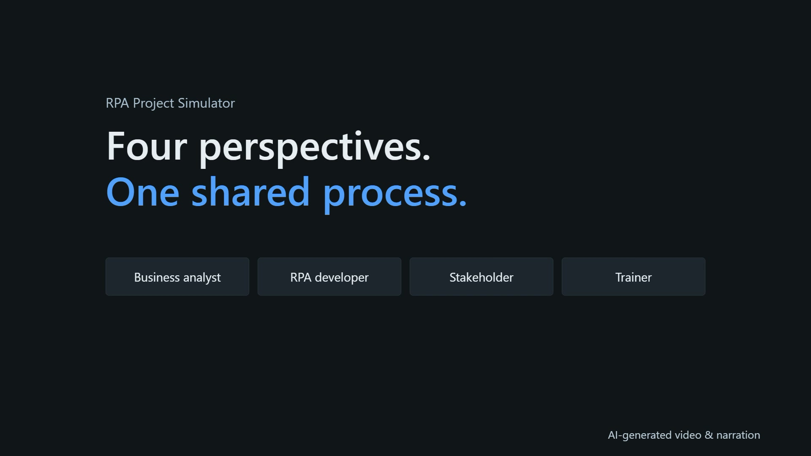

# Four perspectives. One shared process.

[Watch or download the 25-second short](https://github.com/Dragos-cloud/uipath-rpa-project-simulator/releases/download/v0.70/rpa-project-simulator-short-v070.mp4) · [v0.70 release](https://github.com/Dragos-cloud/uipath-rpa-project-simulator/releases/tag/v0.70) · [Live app](https://dragos-cloud.github.io/uipath-rpa-project-simulator/)

The short introduces a shared review view for business analysts, RPA developers, stakeholders and trainers, then highlights importing a project, reviewing requirements alongside code evidence, and asking a local AI for explanations. The complete captured app viewport stays visible; highlights guide attention without detached or cropped inspectors.

| Start | Scene |
| --- | --- |
| 0:00 | Four perspectives. One shared process. |
| 0:04.5 | Import the project |
| 0:08.5 | Requirements meet code evidence |
| 0:14.5 | Local AI. Business language. |
| 0:19.1 | Fewer alignment meetings |

## What the recording shows

The synthetic Customer Order Processing captures and actual local-model response were recorded from app v0.63. This is an edited promotional overview published alongside v0.70, not a complete demonstration of its new document-role/configuration inspector. Local-model text can overstate what the source does; review it against the supplied workflow and PDD. The video does not execute a robot or certify implementation.

The voice is generated with the author's selected ElevenLabs voice. **AI-generated video & narration** remains visible throughout. The author credit is visual only. Output: H.264/AAC MP4, 1920×1080, 30 fps, 25 seconds. The settled opening is both the thumbnail and frame zero.

## Credits

Music: **“Happy Beats / Business Moves Vol. 1” by Sascha Ende**, [ende.app](https://ende.app/en), licensed under [CC BY 4.0](https://creativecommons.org/licenses/by/4.0/). The track is trimmed, faded and mixed beneath narration. Keep this attribution when sharing the video.

UI click sound: Kenney.nl, CC0. Video composition: HyperFrames. Synthetic demo captures: RPA Project Simulator. These media licenses are separate from the repository's MIT code license.

UiPath™ is a trademark of UiPath, Inc. and UiPath SRL. RPA Project Simulator is an independent community tool, not affiliated with, sponsored by, or endorsed by UiPath. No permission or certification is claimed.

## Suggested post

Four perspectives. One shared process. I built RPA Project Simulator to help business analysts, RPA developers, stakeholders and trainers review project files, compare PDD requirements with workflow evidence, and ask a local AI to explain what they see. Alignment. Without another alignment meeting.

Video disclosure: AI-generated narration and AI-assisted production; recorded synthetic app demo and local-model output. Music: Sascha Ende, ende.app (CC BY 4.0), trimmed and mixed.

The MP4 is a release attachment; raw production files, voice files, credentials, private notes and imported projects are excluded from Git history. The full [3:28 walkthrough](README.md) is still available separately.
